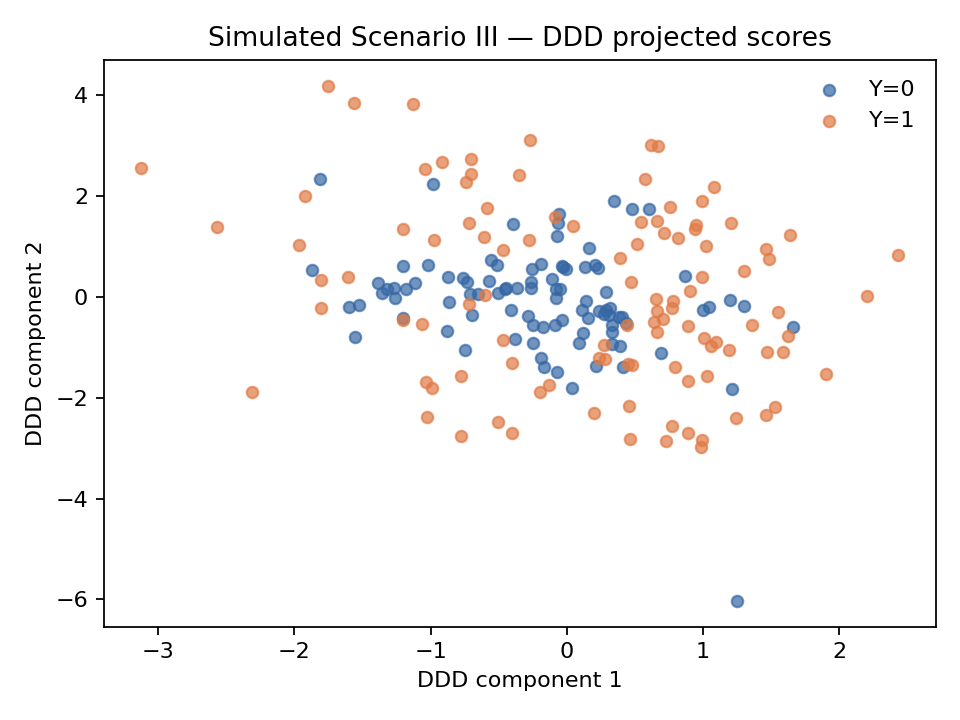

# DDD

**DDD (Distributional Divergence Decomposition)** is a supervised dimension-reduction method for binary outcomes proposed in *Kolmogorov–Smirnov-Based Supervised Dimension Reduction for Gene Expression Classification* by Chun Yin Lee, Yuke Wang, and Kin Yau Wong. DDD extracts linear combinations of predictors that maximize the empirical two-sample **Kolmogorov–Smirnov (KS)** statistic. The constrained, non-differentiable optimization is performed by **differential evolution (DE)**.

This repository provides a **single simulated dataset illustration**: generate binary-response data, fit DDD, and examine the extracted components.

## How to import the functions

Install Python 3 and the dependencies from the repository folder:

```bash
python -m pip install -r requirements.txt
```

Import the functions in Python:

```python
from ddd import generate_data_new, fit_sequential_ddd
```

Alternatively, run the complete demonstration:

```bash
python example_simulated.py
```

## Usage

The module provides two main functions:

| Function | Description |
| --- | --- |
| `generate_data_new(N, p, seed=None)` | Generate **one** dataset with correlated Gaussian predictors and a binary response |
| `fit_sequential_ddd(X, Y, ncomp=1, trace=False, ...)` | Estimate successive unpenalized DDD loading vectors and their empirical KS values |

Internally, `ddd.py` also defines `objective_function`, `repair_vector`, and `differential_evolution_ddd` to evaluate the KS criterion and perform constrained differential evolution.

### `generate_data_new`

```python
generate_data_new(N, p, seed=None)
```

The example uses the nonlinear data-generating model (Scenario III) from the manuscript:

$$
X\sim N_p(0,\Sigma), \qquad \Sigma_{ij}=0.5^{|i-j|},
$$

$$
\eta=\theta_0+(X_1+X_5)^2+\sin(X_3)+X_2X_4,
\qquad
P(Y=1\mid X)=\frac{1}{1+\exp[-3\tanh(\eta)]}.
$$

The code chooses `theta0 = -np.median(raw_eta)` within the generated sample to obtain approximately balanced classes.

| Argument | Description |
| --- | --- |
| `N` | Number of observations |
| `p` | Number of predictors; **at least 5** |
| `seed` | Random seed for reproducible data generation |

Returns `X` (shape `N × p`), `Y` (binary vector of length `N`), and `ptrue` (true response probabilities).

### `fit_sequential_ddd`

```python
fit_sequential_ddd(
    X, Y, ncomp=1, trace=False,
    n_pop=50, f_scale=0.5, cr=0.7,
    max_iter=10000, init_seed=None
)
```

Given standardized predictors and class labels, the method estimates the loading vectors sequentially:

$$
\widehat z_m=\underset{\|z\|_2=1,\ z^\top\widehat z_j=0\ (j<m)}{\arg\max}
\sup_t\left|\widehat F_{z^\top X\mid Y=1}(t)-\widehat F_{z^\top X\mid Y=0}(t)\right|.
$$

Each loading vector has unit Euclidean norm and is orthogonal to previously extracted loading vectors. Orthogonality of loadings **does not guarantee uncorrelated component scores**. The objective is unpenalized; there is **no lambda argument**.

| Argument | Description |
| --- | --- |
| `X` | Standardized predictor matrix, shape `N × p` |
| `Y` | Binary response vector containing both 0 and 1 |
| `ncomp` | Number of extracted directions (`1 <= ncomp <= p`) |
| `trace` | Print empirical KS values during fitting |
| `n_pop` | Number of DE candidates per generation (at least 4) |
| `f_scale` | Differential-evolution mutation scale (default `0.5`) |
| `cr` | Crossover probability (default `0.7`) |
| `max_iter` | Number of DE generations **per component** (default `10000`) |
| `init_seed` | Optional initialization seed for DE candidates; the remaining random draws use NumPy's active RNG |

Returns `weights`, an array of shape `(ncomp, p)` with one unit-norm loading vector per row, and `ks_values`, the corresponding **in-sample** two-sample KS statistics. The projected scores are computed by `X @ weights.T`.

## Example: generate one dataset and estimate DDD

```python
import numpy as np
from sklearn.preprocessing import StandardScaler
from ddd import generate_data_new, fit_sequential_ddd

# Generate a single simulated dataset (200 subjects, 10 predictors).
X, Y, ptrue = generate_data_new(N=200, p=10, seed=1234)

# Standardize the data used for fitting.
X_scaled = StandardScaler().fit_transform(X)

# Quick demonstration: 80 DE generations and 20 candidates.
np.random.seed(2026)
weights, ks_values = fit_sequential_ddd(
    X_scaled, Y, ncomp=3,
    n_pop=20, f_scale=0.5, cr=0.7, max_iter=80
)

# Project observations onto the estimated DDD directions.
scores = X_scaled @ weights.T
print("KS objectives:", np.round(ks_values, 4))
print("Loading-vector inner products:\n", np.round(weights @ weights.T, 5))
```

Output from this example:

```text
KS objectives: [0.4366 0.3043 0.2747]
Loading-vector inner products:
 [[ 1. -0. -0.]
 [-0.  1. -0.]
 [-0. -0.  1.]]
```

The three KS statistics measure the observed distributional separation along each extracted direction. The approximately identity-valued inner-product matrix verifies the unit-norm and mutual orthogonality constraints. These are **training-sample** results, not held-out predictive performance.

For a scatterplot and saved outputs, run `python example_simulated.py`:



The shortened settings make this example practical to run on a personal computer. To use the full optimizer reference settings, adjust `n_pop=50` and `max_iter=10000`, recognizing that computation will be substantially longer.

## Files

| File | Description |
| --- | --- |
| `ddd.py` | Data generator and DDD estimator, with internal optimization functions |
| `example_simulated.py` | End-to-end simulation and DDD illustration on **one dataset** |
| `requirements.txt` | Required Python packages |
| `example_outputs/ddd_simulated_scores.csv` | Simulated labels, true probabilities, and DDD scores |
| `example_outputs/ddd_weights.csv` | Estimated loading vectors |
| `example_outputs/ddd_simulated_scores.png` | Scatterplot of the first two DDD components |
| `example_outputs/summary.json` | Example parameters, KS objectives, and orthogonality check |

## Citation

Lee, C. Y., Wang, Y., and Wong, K. Y. *Kolmogorov–Smirnov-Based Supervised Dimension Reduction for Gene Expression Classification*. Manuscript.

## Notes

- This illustration uses simulated data, not patient measurements.
- The optimizer is stochastic and does not guarantee a global maximizer.
- Higher empirical KS values indicate stronger *in-sample* distributional separation; they do not alone establish predictive accuracy.
- No external data files or R packages are required.
