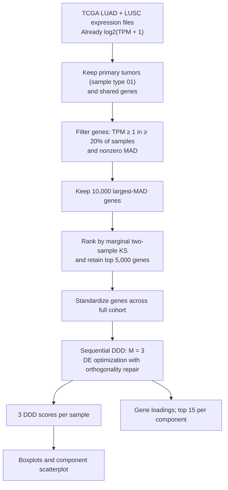

# DDD

**DDD (Distributional Divergence Decomposition)** is a supervised dimension-reduction method for binary classification that extracts linear components by maximizing the two-sample **Kolmogorov–Smirnov (KS)** statistic. The approach is developed in the manuscript *Kolmogorov–Smirnov-Based Supervised Dimension Reduction for Gene Expression Classification* by Chun Yin Lee, Yuke Wang, and Kin Yau Wong.

This repository illustrates DDD using RNA-sequencing expression data from **The Cancer Genome Atlas (TCGA)** to examine differences between **lung adenocarcinoma (LUAD)** and **lung squamous cell carcinoma (LUSC)**. The supplied script reproduces a **whole-cohort exploratory DDD fit for biological interpretation**, rather than a cross-validated predictive-performance experiment.

## Method

Let `X` be the standardized gene-expression matrix with `p_s` selected genes and let the binary outcome be `Y = 0` for LUAD and `Y = 1` for LUSC. DDD estimates the `m`-th loading vector by

$$
\widehat{\boldsymbol z}_m
= \underset{\boldsymbol z}{\operatorname{arg\,max}}\;
\sup_{t\in\mathbb R}
\left|\widehat F_{\boldsymbol z^\top\boldsymbol X\mid Y=1}(t)
-\widehat F_{\boldsymbol z^\top\boldsymbol X\mid Y=0}(t)\right|,
$$

subject to

$$
\|\boldsymbol z\|_2 = 1, \qquad
\boldsymbol z^\top\widehat{\boldsymbol z}_j=0
\quad \text{for }j=1,\ldots,m-1.
$$

The component score for a sample with expression vector `x` is `x @ z_m`. The empirical KS objective measures separation between the **entire distributions** of the scores in the two groups, rather than maximizing variance (PCA) or covariance with the outcome (PLS). DDD constructs successive loading vectors with Euclidean orthogonality; their scores are **not necessarily uncorrelated**.

The source implements a population-based **differential evolution (DE)** optimizer: initialize candidate directions, mutate and cross over trial vectors, project them onto the orthogonal complement of earlier components, normalize, evaluate empirical KS, and retain a trial direction when its KS value strictly improves. DE is a stochastic heuristic and does not guarantee a global optimum. For reporting, component signs are flipped when necessary so that mean scores are higher for LUSC than LUAD.

### Analysis workflow



## Installation

Requires **Python** with the dependencies listed in `requirements.txt`:

```bash
python -m pip install -r requirements.txt
```

The script uses `numpy`, `pandas`, `scipy`, and `matplotlib`. It does not require an R installation.

## Input data

Supply two tab-separated gzip-compressed gene-expression matrices:

| File | Content |
| --- | --- |
| `TCGA-LUAD.star_tpm.gz` | LUAD gene expression |
| `TCGA-LUSC.star_tpm.gz` | LUSC gene expression |

**Important:** The values must **already be on the `log2(TPM + 1)` scale**. Do not give the script untransformed TPM data without adapting preprocessing. In each input file, the first column identifies genes; subsequent columns contain samples. The script transposes the table, filters samples whose TCGA barcode indicates **primary tumor type `01`**, and intersects the gene identifiers present in both cohorts. It assumes standard TCGA sample barcodes and that gene names are consistent between the files.

TCGA files are **not included** in this repository. Obtain appropriate data through the [Genomic Data Commons](https://portal.gdc.cancer.gov/) and follow the applicable access and use requirements.

## How to run the TCGA exploratory analysis

1. Place the two input files on your computer.
2. Open `tcga_ddd_exploratory.py` and change the configuration paths near the beginning of the file:

```python
from pathlib import Path

LUAD_PATH = Path("data/TCGA-LUAD.star_tpm.gz")
LUSC_PATH = Path("data/TCGA-LUSC.star_tpm.gz")
OUTPUT_DIR = Path("tcga_ddd_biological_interpretation_ps5000_fS05")
```

3. Run from the repository directory:

```bash
python tcga_ddd_exploratory.py
```

> The supplied script's default file paths point to the author's local Windows directory; edit them before running. The full settings use `50 × 10,000` DE trial evaluations per component for **three** components, making the analysis computationally intensive. Runtime depends on your computer and dataset.

### Analysis configuration

| Setting in source | Value | Meaning |
| --- | ---: | --- |
| `LOW_EXPR_TPM` | `1.0` | Expression threshold in TPM units |
| `MIN_EXPR_FRAC` | `0.20` | Minimum sample fraction meeting the expression threshold |
| `MAX_VARIABLE_GENES` | `10000` | Maximum number of highest-MAD candidates |
| `P_S` | `5000` | Number of genes retained by marginal KS screening |
| `M` | `3` | Number of sequential DDD components |
| `N_POP` | `50` | DE population size |
| `G_MAX` | `10000` | Maximum DE generations per component |
| `F_S` | `0.5` | DE mutation scale factor (explicitly passed) |
| `CROSSOVER_RATE` | `0.7` | DE crossover probability |
| `RANDOM_SEED` | `20260923` | Seed set before DDD optimization |
| `TOP_GENES_PER_COMPONENT` | `15` | Number of reported high-loading genes |

Expression filtering is implemented on the already-transformed input by checking `log2(TPM + 1) >= log2(2)`, corresponding to **TPM ≥ 1**. Genes must satisfy this threshold in at least **20%** of samples. The candidate set is then filtered by positive median absolute deviation (MAD), ranked by MAD, and screened by marginal KS. Selected features are standardized with the **full-cohort** mean and standard deviation (`ddof=0`).

## Functions

| Function | Description |
| --- | --- |
| `load_and_process_tcga(path, label_value)` | Read and transpose a gene-expression file, retain primary tumors, assign a binary class label |
| `low_expression_and_variability_filter(X_log_tpm)` | Remove low-expression / zero-MAD genes; keep up to 10,000 genes with largest MAD |
| `marginal_ks_ranking(X_df, y)` | Compute two-sample KS for each candidate gene and rank genes from largest to smallest KS |
| `standardize_whole_data(X_df)` | Standardize selected gene columns; return standardized matrix, means, and standard deviations |
| `objective_function(z, X0, X1)` | Compute two-sample KS on projected scores `X0 @ z` and `X1 @ z` |
| `repair_vector(u, previous_components)` | Remove the projection onto earlier loading vectors and normalize the result |
| `differential_evolution_ddd(X0, X1, prev_comps, *, n_pop, f_scale, cr, max_iter)` | Optimize one DDD loading direction with differential evolution |
| `fit_sequential_ddd(X, y)` | Estimate `M` DDD loading vectors sequentially and return loadings, KS statistics, and runtimes |
| `save_component_plots(scores, y, destination)` | Save one subtype boxplot per component and a 2-D scatterplot of components 1 and 2 |
| `run_analysis(luad_path=..., lusc_path=..., output_dir=...)` | Run the complete whole-cohort descriptive pipeline and write result files |

### `differential_evolution_ddd`

```python
differential_evolution_ddd(
    X0, X1, prev_comps,
    n_pop=50, f_scale=0.5, cr=0.7, max_iter=10000
)
```

- `X0`: 2-D NumPy array of standardized predictors for **LUAD (`Y=0`)**.
- `X1`: 2-D NumPy array of standardized predictors for **LUSC (`Y=1`)**.
- `prev_comps`: list of already estimated loading vectors; use `[]` for the first component.
- `n_pop`: number of candidate directions; must allow three distinct donors other than each target (`n_pop >= 4`).
- `f_scale`: differential-evolution mutation scale; the TCGA analysis uses `0.5`.
- `cr`: crossover probability; the TCGA analysis uses `0.7`.
- `max_iter`: number of DE generations; the TCGA analysis uses `10000`.

Returns a **1-D NumPy array** containing one unit-norm loading vector. In the actual function signature, the four DE parameters are required keyword-only arguments; the values shown above are example values passed by the caller, not function defaults.

### `fit_sequential_ddd`

```python
weights, ks_values, times = fit_sequential_ddd(X, y)
```

- `X`: standardized expression array of shape `(n_samples, p_s)`.
- `y`: binary label array, with `0 = LUAD`, `1 = LUSC`.
- `weights`: array of shape `(M, p_s)`; each row is a loading vector.
- `ks_values`: list of final empirical KS statistics for the estimated directions.
- `times`: list of component-specific fitting times, measured in seconds.

This function uses the **module-level settings** `M`, `N_POP`, `F_S`, `CROSSOVER_RATE`, and `G_MAX` rather than accepting them as arguments.

### `run_analysis`

```python
top_df, all_loadings, score_df, summary = run_analysis(
    luad_path=LUAD_PATH,
    lusc_path=LUSC_PATH,
    output_dir=OUTPUT_DIR
)
```

The returned objects are the top-loading gene table, full-loading gene table, component-score table, and metadata dictionary.

## Minimal demonstration without TCGA data

The following smaller synthetic-data example illustrates the **core DE extraction step** without running the full TCGA analysis. Its settings are for demonstration only and do **not** reproduce the paper's results.

```python
import numpy as np
from tcga_ddd_exploratory import differential_evolution_ddd, objective_function

np.random.seed(123)
X0 = np.random.normal(size=(40, 6))
X1 = np.random.normal(size=(40, 6))
X1[:, 0] += 1.0  # example difference between the two groups

vectors = []
for m in range(2):
    z = differential_evolution_ddd(
        X0, X1, vectors,
        n_pop=10, f_scale=0.5, cr=0.7, max_iter=30
    )
    vectors.append(z)
    print(f"DDD component {m + 1}: KS = {objective_function(z, X0, X1):.3f}")

weights = np.vstack(vectors)
X_all = np.vstack([X0, X1])
scores = X_all @ weights.T
print("Loading matrix:", weights.shape)    # (2, 6)
print("Component score matrix:", scores.shape)  # (80, 2)
```

## Generated files

All output files are written inside `OUTPUT_DIR`:

| File | Content |
| --- | --- |
| `ddd_all_5000_gene_loadings.csv` | All 5,000 selected genes; KS rank/statistic, candidate MAD, standardization parameters, and signed/absolute DDD loadings |
| `ddd_top_genes_by_component.csv` | Top 15 genes by absolute loading for each of the three DDD components |
| `ddd_component_scores_all_samples.csv` | Sample identifiers, LUAD/LUSC label, and three DDD component scores |
| `ddd_weights_3_by_5000.npy` | NumPy array of three loading vectors over 5,000 selected genes, shape `(3, 5000)` |
| `ddd_component_1_boxplot.png`, `ddd_component_2_boxplot.png`, `ddd_component_3_boxplot.png` | Class-specific distributions of projected component scores |
| `ddd_component_1_vs_2_scatter.png` | Scatterplot of the first two component scores by subtype |
| `ddd_exploratory_metadata.json` | Input counts, parameters, empirical KS objectives, runtimes, sign orientation, and software/platform metadata |

For interpretation, the gene loadings are contributions to fitted **multivariate projections**; a large loading does not establish differential expression, an independent biomarker effect, or causation. The source preserves gene identifiers as present in the input files (e.g. versioned Ensembl IDs); it **does not perform gene-symbol annotation**.

## Scope and reproducibility

- This implementation is a **descriptive whole-cohort fit**, with **no held-out test data or predictive cross-validation**. Do not use its in-sample KS scores to claim classification performance.
- The larger manuscript also contains simulation experiments, PCA/PLS/penalized SDR comparisons, and downstream classifiers. **Those analyses are not implemented by this script.**
- To reproduce the exact exploratory fit, use the same expression files, gene identifiers and ordering, script settings, package versions, and random seed. The script records its own parameters and environment metadata in JSON, but `requirements.txt` intentionally lists dependencies without pinning versions.
- The source code retains its original default Windows data paths. Change them for your machine before running.

## Reference

Lee, C. Y., Wang, Y., and Wong, K. Y. *Kolmogorov–Smirnov-Based Supervised Dimension Reduction for Gene Expression Classification*. Manuscript; full publication details to be added when available.
